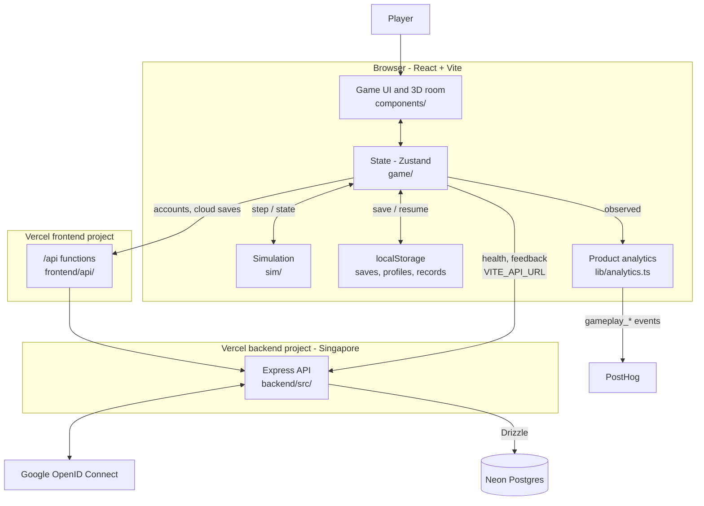
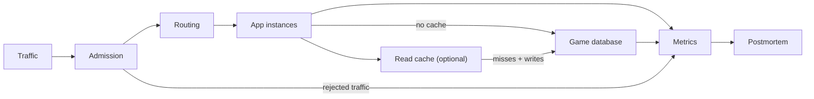

# Architecture

This is the source of truth for how the pieces of 99.99% fit together and where browser data lives.
Gameplay rules are in [GAMEPLAY.md](GAMEPLAY.md), HTTP routes in [api.md](api.md), and hosting in [DEPLOYMENT.md](DEPLOYMENT.md).

## The real application

| Layer | Lives in | Responsibility |
| --- | --- | --- |
| Simulation | `frontend/src/sim/` | Pure, seeded steps, incidents, settlement and reports |
| State and persistence | `frontend/src/game/` | One active company per mode, lifecycle, local saves, guidance models, local records |
| UI and scene | `frontend/src/components/` | Panels, dialogs and the react-three-fiber room |
| Browser services | `frontend/src/lib/` | API client, account proxy handler, PostHog adapter |
| Account proxy | `frontend/api/` | Vercel functions forwarding account and run routes to `API_PROXY_TARGET` |
| API | `backend/src/` | Accounts, sessions, cloud saves, feedback, public stats, health |
| Database | `backend/src/db/schema.ts`, `backend/drizzle/` | Postgres tables and generated migrations |
| Shared contracts | `shared/` | Request and response types used by both packages |

Rules that keep this shape:

- Gameplay is a pure, seeded browser simulation; the UI reads its snapshots and never computes a second outcome.
- The game works without the API: guest play, saves and local records stay in the browser.
- Database and auth secrets stay server-side, and every `VITE_*` value is public.
- Account requests go through the same-origin `/api` proxy so the session cookie is first-party; see [AUTHENTICATION.md](AUTHENTICATION.md).
- Migrations are additive, because Vercel and the production migration deploy at the same time.

## Infrastructure inside the game

These are simulated game objects, unrelated to the real API and database.

## Browser storage

Every key is in `localStorage`, scoped to the origin, so a preview deployment and production never share saves.
Storage can be missing, full or corrupt; each reader validates what it loads and falls back without breaking play.

| Key | Holds | Written by |
| --- | --- | --- |
| `nn.campaign.save.v1` | Guided Mode save: compact input log, schema 7, replayed through the engine | `game/saveEnvelope.ts` |
| `nn.campaign.meta.v1` | Guided Mode profile: walkthrough progress, Challenge Mode unlock, tips seen | `game/persist.ts` |
| `nn.campaign.tutorial.v1` | Practice company during a walkthrough replay | `game/tutorialPractice.ts` |
| `nn.campaign.cloud.v1` | Account bindings, pending snapshots and conflict copies | `game/cloud.ts` |
| `nn.campaign.analytics.v1` | Local playtest records for both modes; never sent anywhere | `game/persist.ts`, `game/telemetry.ts` |
| `nn.classic.save.v1`, `nn.classic.meta.v1` | Challenge Mode save and profile | `game/persist.ts` |
| `nn.campaign.exploration.v1`, `nn.classic.exploration.v1` | Floor in view, walk mode and chosen view, per mode | `game/exploration.ts` |
| `nn.mode.v1` | Last played mode | `game/persist.ts` |
| `nn.audio.v1`, `nn.music.v1` | Volumes and mute; the music key is kept for older builds | `game/persist.ts` |
| `nn.graphics.v1`, `nn.controls.v1`, `nn.map.v1`, `nn.avatar.v1`, `nn.timeOfDay.v1` | Graphics quality, look controls, minimap folded, avatar, time of day | `game/persist.ts` |
| `nn.analytics-consent.v1` | Product analytics opt-out choice | `lib/analytics.ts` |
| `nn.product-analytics.v1` | Product analytics run ledger (last 100 runs) | `game/productAnalytics.ts` |
| `ph_*` | PostHog's anonymous browser identity | PostHog SDK |
| `nn.save.v1`, `nn.meta.v1`, `nn.analytics.v1` | Pre-update saves from the prototype; preserved, exportable and never deleted | Read only |

Loading an older Guided Mode schema (1 to 6) backs up the exact source bytes before replacing them.
Classic import, reset and sign-out never touch the legacy keys.
