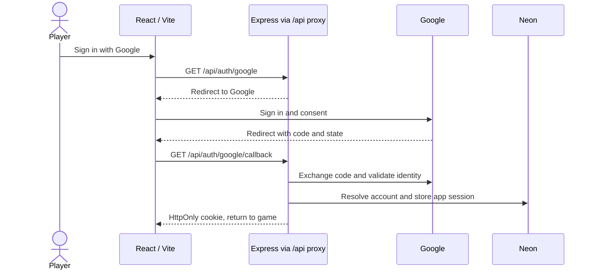

# Authentication and cloud saves

This is the source of truth for accounts, app sessions and cloud saves.
The route list is in [api.md](api.md#account-routes), and general hosting settings are in [DEPLOYMENT.md](DEPLOYMENT.md).

Accounts are optional.
Players can sign in with Google (OAuth 2.0 with OpenID Connect) or with an email and password, and guest play always remains available, including when accounts are unconfigured or offline.
The Account dialog opens from the home screen's account chip and from Menu > Account.
Opening the game at `/?signin=1`, as the landing page's account links do, opens the dialog for a signed-out player once the session check answers, then removes the flag from the address.
Owner: Di Heng.

## Google sign-in flow

## Identity and sessions

| Concern | Contract |
| --- | --- |
| Google | Backend authorization code flow with scopes `openid email profile`, using `openid-client`; the client secret and code exchange stay in Express |
| Callback | State, nonce and PKCE verifier are short-lived, single-use, bound to the initiating browser and atomically consumed; mismatches and replays are rejected; the ID token's signature, issuer, audience, expiry and nonce are validated |
| Account | The verified issuer and `sub` identify a Google account; email and name are profile fields, so an email change never creates a new owner |
| App session | A random opaque token in a host-only `nn_session` cookie (`HttpOnly; Secure; SameSite=Lax; Path=/`); only its hash is stored, with the account and expiry; it rotates on sign-in and is revoked on sign-out; local HTTP may omit `Secure` for localhost only |
| Private API | Every save read and write is filtered by owner and expected revision; state-changing routes need the exact `APP_ORIGIN` and the session's CSRF token; expired sessions get 401 and local changes are kept |
| Caching | Auth, session and private save responses send `Cache-Control: private, no-store` and CDN `no-store` |

## Email and password accounts

The Account dialog can also create an account with an email and password.
Register and login answer with the same `AppSession` and cookie as Google sign-in through the shared `startSession` helper, and sign the player in without a reload.

| Concern | Contract |
| --- | --- |
| Identity | Issuer `email`, with the trimmed, lowercased address as subject; an email account never merges with a Google account at the same address |
| Password | 8 to 200 characters, hashed with scrypt (N=16384, r=8, p=1, 16-byte salt, 64-byte key) as `scrypt$N$r$p$salt$key` in `game_email_credentials` and compared with `timingSafeEqual`; unknown emails still pay for one hash |
| Abuse | Exact `APP_ORIGIN` required as `Origin`, which blocks login CSRF; a wrong email and a wrong password give the same 401; ten wrong passwords lock the account for 15 minutes (429) |

Not built yet: email verification, password reset and per-IP rate limits.
Registration therefore reveals that an address has an account, and someone could register an address they do not own; that gives them no access to other saves but blocks the real owner.
Add verification and reset, which need an email provider, before relying on email accounts for more than game saves.

## Cloud saves

- Signing up saves the guest run to the new account without asking, because a new account has no cloud saves and no other owner.
  The session that created the account, by Google or email registration, is marked `created_account` and answers `AppSession.newAccount: true` until the account holds a cloud save.
  While that is true, the open Guided Mode company is uploaded once per page: right after email registration, after the Google redirect reloads the page, or when a Guided Mode company opens later.
  The player sees "Your progress is saved to your account." A failed upload keeps the local save, shows a toast and the reason in Account, and leaves Save to cloud to retry; the next page load tries once more.
- Signing in to an existing account never uploads a guest run: the player chooses Save to cloud. A returning sign-in in any browser is never marked new.
- Neither path uploads a run bound to another account in this browser, and a first upload never overwrites a cloud save: a run ID held by another account is refused with 409.
- Cloud saves are Guided Mode compact replay envelopes (schemas 3 to 7), at most 1 MiB; oversized or incompatible saves stay local and exportable. Challenge Mode stays local.
- The frontend fully validates a cloud save through the engine before loading it. The API stores envelopes; it is not an anti-cheat engine.
- Account bindings live in `nn.campaign.cloud.v1` and survive sign-out. Pending snapshots stay local during errors or expiry, and Save to cloud retries.
- A revision conflict asks the player to choose and keeps both versions. Download backup (Account > Backup) includes preserved snapshots and conflict copies.
- Switching accounts never uploads another owner's local run, and sign-out or reset never erases local or legacy saves.

## Deployment

Explicit function files under `frontend/api/` serve the session, Google sign-in and callback, email register and login, logout and run routes through `frontend/src/lib/accountProxyHandler.ts`.
Vercel's plain Vite functions do not support catch-all routes, so each nested endpoint needs its own file and an entry in the proxy allowlist.
The proxy forwards only those paths to the server-only `API_PROXY_TARGET`, passes cookies, separate `Set-Cookie` headers, redirects, `Origin` and CSRF, and disables caching.
Locally, Vite forwards `/api` to `localhost:3001`.

To enable accounts in an environment:

1. Set the backend's `GOOGLE_CLIENT_ID`, `GOOGLE_CLIENT_SECRET`, `GOOGLE_REDIRECT_URI` and `APP_ORIGIN` for the browser-facing origin.
2. Set the frontend's `API_PROXY_TARGET` to the verified HTTPS backend origin.
3. Register the exact `<frontend-origin>/api/auth/google/callback` with Google for production, local development and one stable auth-test preview, and configure the consent screen's audience. Other previews stay guest-only.

## Outstanding acceptance

Automated tests use a mocked Google exchange and an in-memory database ([testing.md](testing.md#accounts-and-cloud-saves)).
Still unverified on a real deployment: sign-in with two real Google accounts, cancellation, returning-user login, expiry and logout, callback replay rejection, cookie forwarding through the proxy, private cache headers, fresh-browser resume, account switching and a concurrent revision conflict.
